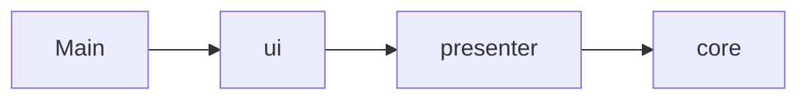
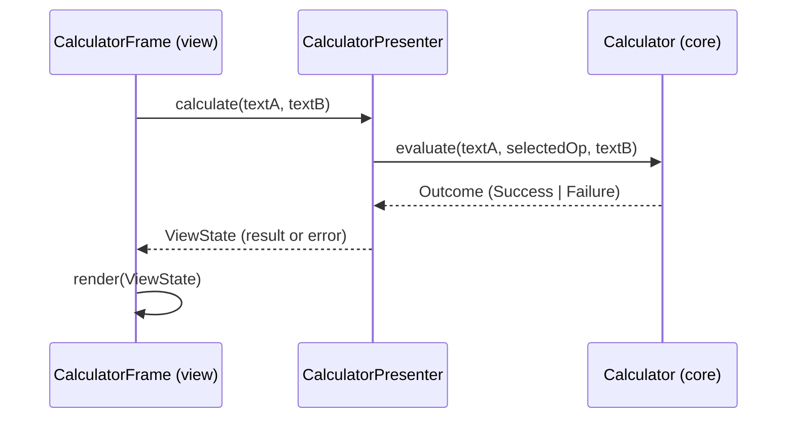

# Architecture Spine — Baseline Desktop Calculator

## Design Paradigm

Layered, with a pure functional core. Dependencies point inward only.

| Layer | Package | Responsibility |
| --- | --- | --- |
| core | `calculator.core` | Parse, validate, compute, format. Pure; no AWT/Swing. |
| presenter | `calculator.presenter` | Holds interaction state, turns user events into `ViewState`. No AWT/Swing. |
| view | `calculator.ui` | Passive Swing rendering of `ViewState`; forwards events. |
| entry | `calculator.Main` | Starts the view on the Event Dispatch Thread. |

## Invariants & Rules



### AD-1 — Dependency direction
- **Binds:** all, NFR-4
- **Prevents:** calculation or validation logic creeping into Swing listeners; untestable code.
- **Rule:** `core` and `presenter` must not import `java.awt.*` or `javax.swing.*`. `core` must not import `presenter` or `ui`; `presenter` must not import `ui`. Enforced by a unit test that scans imports.

### AD-2 — Total core API
- **Binds:** FR-4, FR-7, FR-9, NFR-3
- **Prevents:** exceptions escaping to the UI; two ways of reporting errors.
- **Rule:** `Calculator.evaluate(String a, Operation op, String b)` is the only entry into the core. `op` may be `null`. It never throws for any input and returns a sealed `Outcome` = `Success(String text)` | `Failure(ErrorKind kind)`.

### AD-3 — Exact decimal arithmetic
- **Binds:** FR-4, FR-8
- **Prevents:** binary floating-point artefacts, inconsistent rounding.
- **Rule:** All numeric values in `core` are `java.math.BigDecimal`. `double`/`float` are forbidden in `core`. Parsing uses `new BigDecimal(String)` only after the Valid Number grammar check (AD-5).

### AD-4 — Single display and message source
- **Binds:** FR-7, FR-8, FR-9
- **Prevents:** divergent formatting or error wording between layers.
- **Rule:** Result text is produced only by `ResultFormatter.format(BigDecimal)`: `stripTrailingZeros().toPlainString()`, zero normalised to `"0"`. Division is `divide(b, 10, RoundingMode.HALF_UP)` before formatting. Error text comes only from `ErrorKind.message()`: `EMPTY_OPERAND` → "Enter both numbers", `NO_OPERATION` → "Select an operation", `INVALID_NUMBER` → "Invalid number", `DIVIDE_BY_ZERO` → "Cannot divide by zero". No other user-visible error strings.

### AD-5 — Validation order and grammar
- **Binds:** FR-7, FR-9, FR-10
- **Prevents:** different errors for the same input in different code paths.
- **Rule:** Checks run in this order and stop at the first failure: (1) either operand blank after `strip()` → `EMPTY_OPERAND`; (2) `op == null` → `NO_OPERATION`; (3) operand not matching `-?\d+(\.\d+)?` → `INVALID_NUMBER`; (4) divisor compares equal to zero → `DIVIDE_BY_ZERO`. Operands are trimmed before matching. The regex lives in one constant in `core`.

### AD-6 — Presenter owns all state
- **Binds:** FR-3, FR-5, FR-6, FR-10
- **Prevents:** state split between text fields and variables; stale results or errors.
- **Rule:** The presenter holds the only mutable state (selected `Operation`) and publishes an immutable `ViewState(String operandA, String operandB, Operation selected, String result, String error)`. The view renders a `ViewState` and never decides content. Every transition keeps exactly one of `result`/`error` non-empty after Calculate and both empty after Clear (FR-6, FR-10). Selecting an operation does not clear result/error. `[ASSUMPTION]`

### AD-7 — Operation is the extension point
- **Binds:** FR-3, FR-4, NFR-4
- **Prevents:** scattered `switch` statements per operation.
- **Rule:** `Operation` is an enum of symbol, label and a `BinaryOperator<BigDecimal>`-style function; adding an operation touches only the enum plus the view's button list. The divide-by-zero check is expressed in the core evaluation path, not in the view.

### AD-8 — Threading
- **Binds:** FR-2, NFR-2, NFR-3
- **Prevents:** Swing thread-safety defects.
- **Rule:** The window is constructed and mutated only on the Event Dispatch Thread (`SwingUtilities.invokeLater` in `Main`). Calculation is synchronous on the EDT (NFR-2: sub-100 ms).

### AD-9 — Identifiable controls
- **Binds:** FR-1, FR-3, FR-4, FR-6, FR-7
- **Prevents:** tests and evidence that cannot reliably find controls.
- **Rule:** Every control has a visible label/text and a stable `setName(...)`: `operandA`, `operandB`, `op-add`, `op-subtract`, `op-multiply`, `op-divide`, `calculate`, `clear`, `result`, `error`. Enter in either operand field triggers Calculate (D-02). Errors render inline in the `error` label; no modal dialogs.

### AD-10 — Testability and build
- **Binds:** NFR-4, NFR-5
- **Prevents:** tests that need a display; irreproducible builds.
- **Rule:** Acceptance logic (BASE-AC-04…14, 16) is tested against `Calculator` and the presenter without a display. GUI tests use `Assumptions.assumeFalse(GraphicsEnvironment.isHeadless())`. Maven only; `sourceDirectory=src`, `testSourceDirectory=tests`; `JAVA_HOME` is pinned to Corretto 22 in all documented commands.

## Consistency Conventions

| Concern | Convention |
| --- | --- |
| Naming | Packages `calculator.*`; classes UpperCamelCase; test class `<Class>Test`; test methods name the `BASE-AC-nn` they verify, e.g. `baseAc07_divide_7_by_2_gives_3_5`. |
| Data & formats | Operands are `String` at the core boundary; results are `String`; no `null` strings (use `""`). |
| State & cross-cutting | No static mutable state; no logging framework; no config files; no persistence. |

## Stack

| Name | Version |
| --- | --- |
| Java (Amazon Corretto) | 22.0.2, `maven.compiler.release` 22 |
| Apache Maven | 3.9.16 |
| Swing | JDK built-in |
| JUnit Jupiter | 6.1.3 |
| maven-compiler-plugin | 3.16.0 |
| maven-surefire-plugin | 3.6.0 |
| exec-maven-plugin | 3.6.4 |

## Structural Seed

```text
bmad-calculator/
  pom.xml
  src/calculator/
    Main.java
    core/    Calculator.java Operation.java Outcome.java ErrorKind.java ResultFormatter.java
    presenter/ CalculatorPresenter.java ViewState.java
    ui/      CalculatorFrame.java
  tests/calculator/
    core/ presenter/ ui/ ArchitectureRulesTest.java
```



## Capability → Architecture Map

| Capability / Area | Lives in | Governed by |
| --- | --- | --- |
| FR-1 Enter operands | `ui.CalculatorFrame` | AD-9 |
| FR-2 Launch offline | `Main`, `ui` | AD-8 |
| FR-3 Select operation | `core.Operation`, presenter, `ui` | AD-6, AD-7, AD-9 |
| FR-4 Calculate | `core.Calculator` | AD-2, AD-3, AD-5 |
| FR-5 Consecutive calculations | presenter | AD-6 |
| FR-6 Clear | presenter | AD-6 |
| FR-7 Invalid/incomplete input | `core.Calculator`, `ErrorKind` | AD-4, AD-5 |
| FR-8 Display Policy | `core.ResultFormatter` | AD-3, AD-4 |
| FR-9 Division by zero | `core.Calculator` | AD-4, AD-5 |
| FR-10 Error recovery | presenter | AD-6 |
| NFR-2 Responsiveness | all | AD-8 |
| NFR-3 No crash | `core.Calculator` | AD-2 |
| NFR-4 Separation | all | AD-1, AD-7 |
| NFR-5 Reproducible build | `pom.xml`, README | AD-10 |

## Deferred

- Runnable-jar packaging versus `exec:java` as the "documented command": decided in the build story.
- Layout details (grid, fonts, sizes): free in the view; not an invariant.
- Evidence form for BASE-AC-01 (manual/screenshot): needs team decision.
- Internationalisation, accessibility beyond labelled controls, and logging: out of baseline scope.
